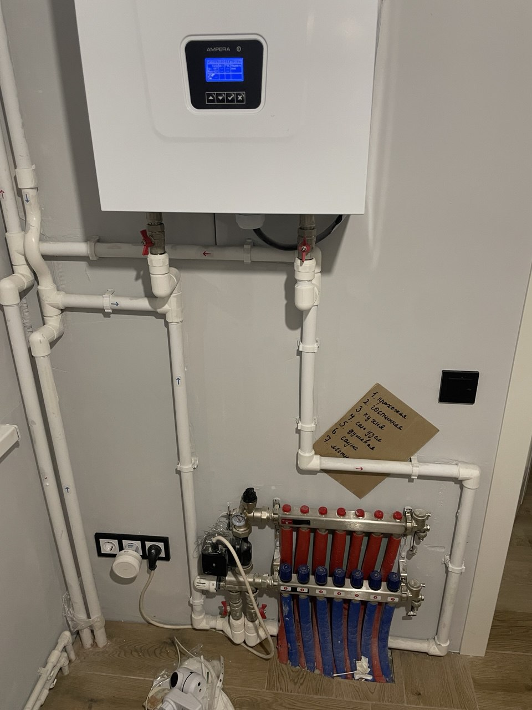
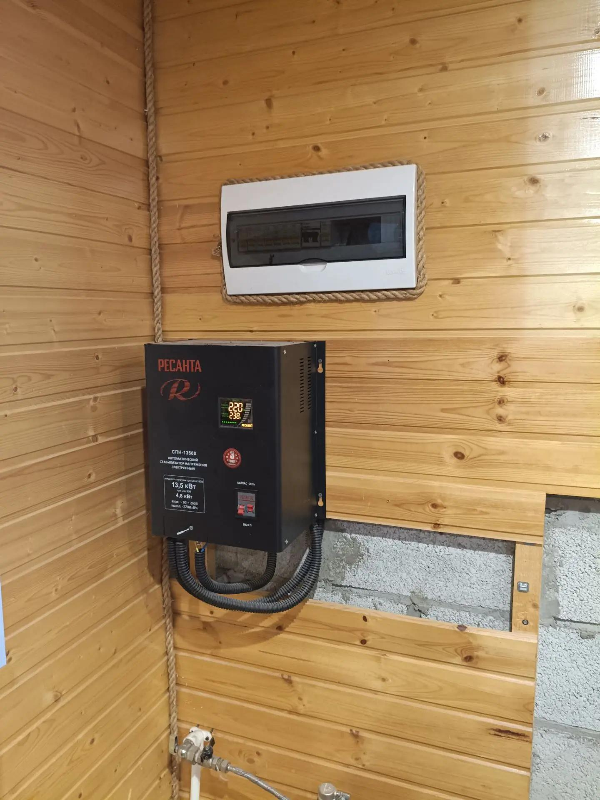
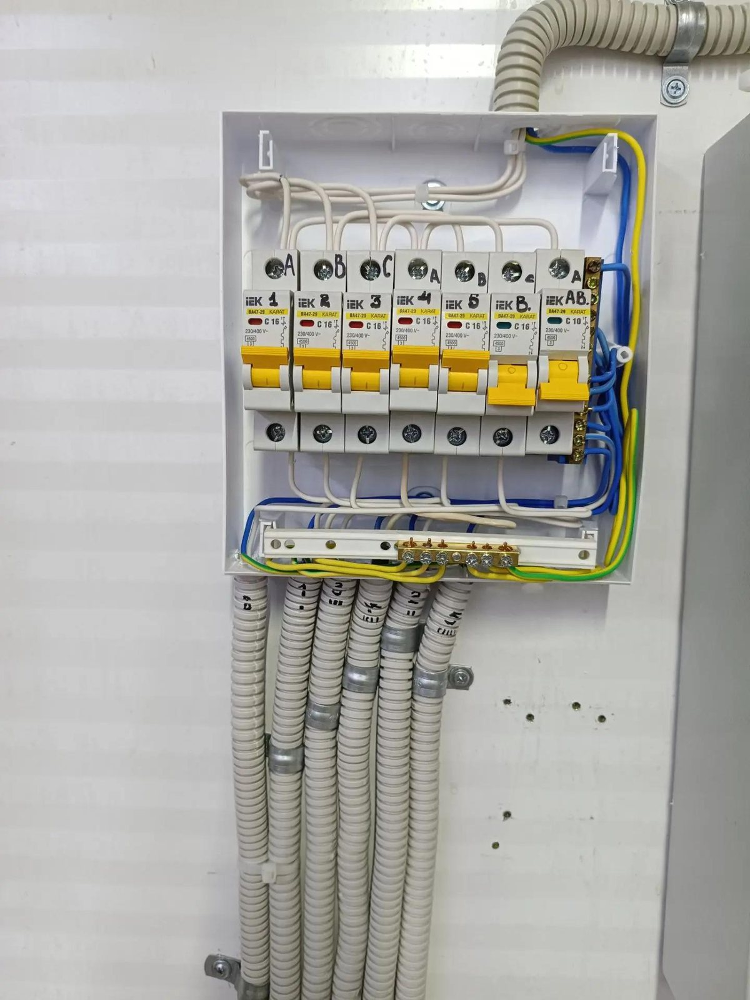

Ночью на улице минус двадцать, а в доме снялись автоматы — и вместе с ними отключился электрокотёл. Через час вода в радиаторах уже остывает, трубы в неотапливаемом углу рискуют пострадать. Электрическое отопление в частном доме простое по идее: нет дымохода и газовой трубы. Зато к котлу предъявляются жёсткие требования по вводу, щитку и кабелю — иначе счёт за свет, скачки напряжения и отключения превращаются в отдельную головную боль.

Ниже — как на практике подходят к выбору мощности электрокотла, что уточняют по электросети до покупки котла, каким сечением вести отдельную линию и чем её защитить. Для Самары и области актуальна и зимняя нестабильность напряжения в посёлках: про резерв для насоса и автоматики котла есть отдельный [разбор про ИБП и генератор](/blog/rezervnoe-pitanie-kotla-nasos-ibp-generator/). Подключение вводного кабеля и работа под напряжением в щитке — только для квалифицированного электромонтёра.

## Чем электрокотёл отличается от «обычной» нагрузки

Электрокотёл — не микроволновка, которая греет две минуты. В холодную погоду ТЭНы (нагревательные элементы) могут держать высокую мощность долго: то работают все ступени, то поочерёдно, в зависимости от схемы котла и термостата. Линия к котлу не должна делить провод с розетками кухни и подогревом пола «на один автомат».

Типичная схема в загородном доме: отопительный контур (радиаторы, тёплый пол, насосы, клапаны) — сантехника, а питание котла и насосов — отдельная электрическая линия от щитка. Свет в доме при аварии на отоплении желательно оставлять живым: для этого линии разделяют по группам. Общие принципы щитка — в статье [щиток в частном доме: сколько автоматов нужно](/blog/shchitok-v-chastnom-dome/).

На снимке — связка «котёл + коллектор»: здесь важны и гидравлика, и надёжное питание насосов. Отключение электрики в такой узел бьёт по всему дому сразу.

## Мощность котла: с чего начать расчёт

Заводские таблицы «кВт на квадратный метр» дают лишь ориентир. Реальная теплопотребность зависит от утепления, площади остекления, высоты потолков, региона и того, живёте ли вы в доме зимой постоянно или подогреваете его «на выходные».

На практике мастера сначала смотрят проект теплопотерь или хотя бы паспорт дома (каркас, СИП, кирпич), затем сопоставляют с паспортом котла. Запас «в два раза больше таблицы» без расчёта ведёт к переплате за сам котёл и за каждый киловатт-час зимой. Занижение — к тому, что котёл не вытянет мороз, а электроника будет вечно в пике.

Полезный приём: разделить задачу на **основной обогрев** и **догрев в пике**. Многие котлы умеют работать по ступеням или поочерёдно подключать ТЭНы — тогда кратковременная пиковая нагрузка на сеть ниже, чем «номинал по бирке», но паспортные токи всё равно считают по максимальной схеме включения. Точное число киловатт для вашего дома назовут только после теплотехники; в блоге нет готовой цифры «под ваш адрес».

> **Совет мастера:** до покупки котла выпишите, что ещё будет греться зимой одновременно: бойлер, тёплый пол, сушилка, обогрев гаража. Эти потребители попадают в **разрешённую мощность по договору с сетью**, а не только в мощность ТЭНов.

## Ввод, фазы и договор: что спросить до монтажа

Электрокотёл на **одну фазу 230 В** чаще ставят на относительно скромные объекты, где и договорная мощность скромная. Котлы на **три фазы 380 В** делят нагрузку между фазами ровнее — это важно, если дом уже близок к лимиту по контракту.

До заказа котла имеет смысл узнать у энергоснабжающей организации (или по документам на дом):

| Вопрос | Зачем |
|--------|--------|
| Сколько кВт разрешено по договору | Котёл + остальной дом должны влезать в лимит |
| Однофазный ввод или три фазы | От этого зависит модель котла и сечение ввода |
| Где стоит граница балансовой ответственности | Кто тянет кабель от опоры до дома |
| Есть ли запас в щите на месте под аппараты | На линию котла нужен отдельный автомат, часто УЗО или дифавтомат |

В посёлках и на селе Самарской области зимой напряжение иногда «плавает». Для чувствительной электроники котла нередко обсуждают стабилизатор или кратковременный ИБП на автоматику и насос — не обязательно на все ТЭНы сразу. Стабилизатор сам по себе — большой потребитель по току на вводе, место в щитке и его кабель тоже считают.

На фото видно типичную картину: рядом со щитком висит мощный стабилизатор. Так бывает, когда ввод слабый, а техника чувствительна к просадкам — электрокотёл в эту историю включают осознанно, а не «поставили по совету соседа».

## Кабель от щитка до котла

Линию к котлу ведут **отдельным кабелем** от щитка — без промежуточных розеток. Марку кабеля для стационарной проводки в жилых зонах часто берут с индексом негорючей оболочки (в быту встречается **ВВГнг-LS** и аналоги по ГОСТу на силовые кабели). Сечение жилы и число жил (3 или 5) зависят от фазности, длины трассы и паспортного тока котла.

Общие ориентиры (не замена расчёта по длине и способу прокладки по **ПУЭ**, глава 7.1, и действующим нормам на кабели):

| Условие | На что смотрят |
|---------|----------------|
| Длина трассы | Чем дальше щиток от котла, тем больше падение напряжения |
| Прокладка | В гофре по стене, в лотке, открыто — по-разному по допустимому току |
| Пусковые токи | У котла они не как у насоса, но аппарат защиты подбирают по паспорту |
| Запас | Оставляют место, если потом добавится мощный бойлер в том же щитке |

Трассы в каркасе и СИП-доме обычно прячут в гофре по несгораемым основаниям, с фотофиксацией до зашивки стен. Пересечения с деревом — только по правилам для горючих оснований; конкретная схема зависит от проекта дома.

Клеммы в коробке котла затягивают по моменту, соединения в щитке — на гильзах или в проверенных зажимах, не «на скрутку». Алюминий от старых линий к медным клеммам котла без правильного перехода со временем греется.

## Защита в щитке: автомат, УЗО, подписи

На отдельную линию электрокотла ставят **автоматический выключатель** по номиналу, указанному в инструкции к котлу или в проекте. Характеристика **C** для нагревательной нагрузки — обычный вариант, но окончательный выбор делают по паспорту и кривой отсечки.

Отдельный **УЗО** или **дифавтомат** на мокрые и ответственные зоны — тема для всего дома; линию котла часто выделяют так, чтобы при утечке или при перегрузке кухни отопление не отваливалось вместе со светом в детской — если это заложено в проект. Жёстко связывать всё на один дифавтомат без схемы — типичная экономия, которая потом мешает жить.

Снимок — аккуратная сборка щитка: видно, сколько места занимают автоматы, когда групп много. Под линию мощного котла и перспективу (бойлер, зарядка авто) запас по модулям закладывают заранее.

> **Совет мастера:** подпишите автомат котла на шильдике так, чтобы через год было понятно без схемы: «котёл», «насосы ОВ», «ТП электрический». На сдаче объекта хозяину оставляют однолинейную схему — хотя бы фото или лист в папке с паспортом котла.

Землю и ноль не «объединяют» в щитке ради удобства. Контур **заземления** для дома с металлическим корпусом котла и сантехникой обсуждают на вводе; замеры оформляют по действующим правилам. Самодельные «гвоздь в сырой стене» для PE с мощным котлом не считаются.

## Типовые ошибки до первого мороза

**Котёл купили, а ввод на 8 кВт не тянет.** Лечится либо увеличением разрешённой мощности (процедура у сетевиков), либо другой схемой отопления — но не «автомат побольше».

**Одна розетка на котёл через удлинитель.** ТЭНы и вибрация насосов любят плохой контакт; отдельная линия — не прихоть.

**Нет места в щитке под второй бойлер или кондиционер.** При проектировании [групп линий](/blog/shchitok-v-chastnom-dome/) закладывают 20–30 % свободных модулей.

**Игнор просадок напряжения.** Котёл в ошибке, а хозяев нет — снова риск промерзания. Следят за журналом ошибок по инструкции и за скачками на вводе.

**Общий автомат «на весь дом».** Выбило одну ветку — отключилось всё, включая насос. Разделяют по смыслу нагрузки.

## Что запомнить

- Мощность электрокотла считают от теплопотерь дома и режима проживания, а не «на глаз» по метрам.
- До покупки проверяют договорную мощность, число фаз и состояние ввода — котёл должен влезать в **лимит сети** вместе с остальным хозяйством.
- От щитка к котлу ведут **отдельный кабель** с сечением и защитой по паспорту и проекту; соединения — в щитке и на клеммнике котла, без самодеятельности.
- В щитке — **отдельный автомат** на линию, грамотная разводка групп, подписи и схема; при нестабильном напряжении обсуждают стабилизацию и резерв на автоматику.
- Работы на вводе, в щитке и с заземлением — с подготовленным электромонтёром; нельзя экспериментировать под напряжением.

Если для каркасного или СИП-дома в Самаре и области нужно спроектировать ввод, щиток и линию под электрокотёл — [оставьте заявку на сайте](https://electric.vim-scrum.ru/#final-cta): посчитают смету по объекту и подскажут, что подготовить до выезда. Бесплатный расчёт стоимости работ по описанию и схемам — да; выезд мастера на замер — по договорённости.
