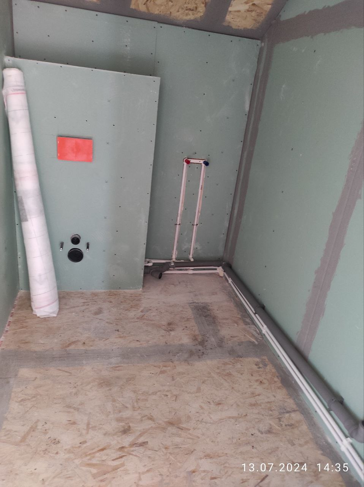
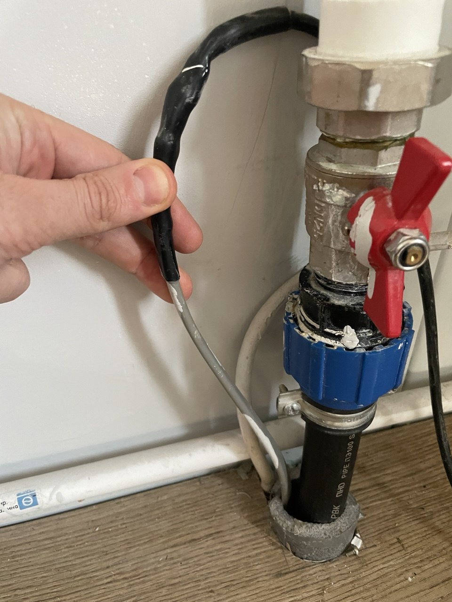
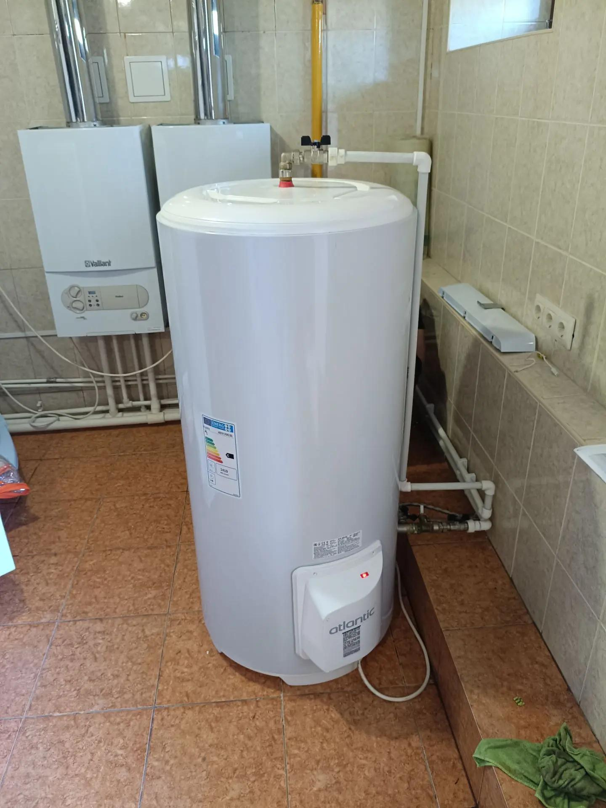

Утром насос гудит, а из крана не идёт вода. Или идёт тонкой струйкой и тут же встаёт. Частая зимняя картина в частном доме: ночью прихватило короткий холодный кусок, и весь водопровод остановился. Иногда вместо крана «молчит» канализация на холодном выпуске. Греющий кабель как раз про эти места. Он не заменяет ни глубину траншеи, ни утеплитель, ни нормальный уклон.

Ниже — где греющий кабель для водопровода и канализации частному дому действительно нужен, чем саморегулирующийся отличается от резистивного и как линию подключают, чтобы труба не перегрелась. Текст для тех, кто строит дом или готовит уже жилой к зиме в Самаре и области. Щиток здесь не разбираем по шагам: работу под напряжением делает электромонтёр.

Мощность на метр, предельная длина и ток у разных марок разные. Эти цифры берутся из паспорта конкретного кабеля, а не «как у соседа».

## Когда греющий кабель для водопровода действительно нужен

Вода замерзает там, где труба долго стоит на морозе и по ней нет постоянного протока. В частном доме таких мест немного, и они повторяются.

| Ситуация | Что делают |
|---|---|
| Трасса ниже промерзания, ввод короткий и утеплён | Кабель не ставят, следят, чтобы утеплитель на входе не сполз и не намок |
| Открытый участок, холодный цоколь, продуваемый короб | Кабель и утеплитель вместе: одно без другого на ветру проигрывает |
| Дом зимой пустует, воду можно слить | Воду сливают. Кабель не замена сливу |
| Канализация идёт свободно и находится в тепле | Кабель не нужен |
| На холодном выпуске или мелком участке вода может стоять | Сначала уклон и провисы, кабель — на оставшийся холодный кусок |
| Труба уже в земле, копать нельзя, вода питьевая | Смотрят внутренний кабель с пищевой оболочкой, не «любой с полки» |

В Самарской области грунт зимой промерзает глубоко, поэтому «закопали на штык лопаты» — это ещё не защита. Но и обматывать греющим кабелем тёплый санузел нет причины: там труба и так в тепле дома.

Если дом на зиму закрывают и воду можно слить, слив надёжнее кабеля. Кабель бесполезен без электричества. На селе и в садовых товариществах свет в непогоду иногда пропадает, и как раз в крепкий мороз. Утеплитель даёт запас по времени, кабель без света не даёт ничего. В чек-листе [подготовки частного дома к зиме](/blog/podgotovka-doma-k-zime-elektrika-santehnika/) эта развилка уже есть: либо дом под присмотром и с питанием, либо систему консервируют.

> **Совет мастера:** греющий кабель ставят до устойчивых морозов. Искать мёрзлую трубу под снегом и подключать линию в темноте тяжелее, чем сделать то же самое, пока сухо и до трассы ещё можно дотянуться.

До визита мастера стоит сфотографировать ввод: откуда труба выходит из земли, из какого она материала, есть ли утеплитель, где щиток и есть ли в нём свободное место. Длину холодного участка меряют рулеткой, вместе с кранами и поворотами. Отдельной линии нужен свой модуль. Иногда нужно место и под УЗО (устройство защитного отключения — оно снимает напряжение при утечке на трубу), если подходящего аппарата в щите ещё нет.

## Водопровод и канализация замерзают по-разному

Напорная труба заполнена водой. Короткая ледяная пробка на вводе оставляет дом без воды, даже если остальная трасса цела. Лёд ещё и распирает трубу: при замерзании вода расширяется примерно на девять процентов. Рвёт часто не саму пробку, а ближайшее соединение. Течь проявляется в оттепель и выглядит как внезапная авария, хотя лёд стоял ещё с мороза.

Канализационная труба обычно заполнена не целиком. При нормальном уклоне вода прошла и ушла, замерзать почти нечему. Канализация замерзает там, где вода задерживается: провис, контруклон, мелкий уличный участок, холодный выпуск через цоколь, подход к септику. Симптом чаще не лопнувшая труба, а подъём воды в доме.

Греющий кабель на канализации не наматывают «на всякий случай» по тёплому стояку. Ищут холодный кусок, где жидкость может стоять. Если провис ещё можно поправить, сначала убирают застой: кабель на кривой трубе маскирует ошибку, а не лечит её. Иней на оголовке фановой трубы — другая задача, про обогрев вентиляционного выпуска на крыше. К кабелю вдоль канализации в земле она не сводится.

Внутрь канализационной трубы кабель не заводят. Среда там для оболочки тяжёлая, нитка собирает грязь и мешает прочистке. Обогрев канализации, если он нужен, кладут снаружи и только под утеплитель.

На снимке санузел до отделки: белые трубы водоснабжения, серая канализация и инсталляция унитаза. Когда помещение отапливается, этому узлу греющий кабель, как правило, не нужен. Пока трассу не зашили, видно, не ныряет ли труба в холодный угол, цоколь или наружную стену. После гипсокартона тот же метр защиты превращается во вскрытие.

## Саморегулирующийся или резистивный

На трубах встречаются два разных кабеля, и путать их потом приходится переделывать.

**Резистивный** греет с постоянной силой, пока подано напряжение. Обычный отрезок резать нельзя: длина задана на заводе. Зональный режут только по меткам. Перехлёст недопустим: в точке пересечения тепло складывается, оболочка может поплыть. Терморегулятор обязателен. ПНД и полипропилен переносят местный перегрев хуже стали. Если датчик отказал или кабель лёг сам на себя, резистивный продолжает греть с той же силой.

**Саморегулирующийся** устроен иначе. Вдоль идут две токопроводящие жилы, между ними полимерная матрица. На холоде она пропускает больше тока, и кабель греет сильнее. В тепле отдача падает. Перехлёст ему обычно не так опасен, но последнее слово за паспортом конкретной марки. Отрезать по месту можно, конец обязательно заделывают штатной муфтой: открытый торец боится воды.

Такой кабель — не выключатель. На небольшом плюсе он чаще всего всё ещё потребляет энергию, только меньше. Терморегулятор желателен и здесь: он не даёт греть уже тёплую трубу всю зиму.

У холодного саморегулирующегося кабеля пусковой ток в первые секунды бывает заметно выше тока прогретого кабеля. Автомат и холодный конец выбирают по паспорту с учётом этого пуска. Если аппарат отключается только в момент включения, это не повод поставить номинал больше. Более крупный автомат перестаёт защищать провод. Та же логика, что в статье [почему зимой выбивает автомат](/blog/vybivaet-avtomat-zimoj/): автомат бережёт линию, а не «мешает жить».

| | Резистивный | Саморегулирующийся |
|---|---|---|
| Теплоотдача | Постоянная, пока включён | Выше на холоде, ниже в тепле |
| Резать по месту | Обычный нельзя; зональный — только по меткам | Можно, затем концевая муфта |
| Перехлёст витков | Нельзя | Обычно допускается, решают по паспорту |
| Терморегулятор | Обязателен | Желателен |
| Пластиковая труба | Выше риск местного перегрева | Чаще подходит, если паспорт разрешает пластик |

Бухту любого греющего кабеля не включают в розетку «проверить, тёплый ли». Смотанный кабель отдаёт тепло не так, как расправленный на трубе. Резистивный в бухте перегревается быстро, саморегулирующийся тоже не рассчитан на работу клубком. Мощность «с запасом, чтобы наверняка» на пластике опаснее честного подбора: удельную мощность выбирают по диаметру, утеплителю и ветру, а не по принципу «помощнее».

## Как кабель лежит на трубе

Пока до трубы можно дотянуться, предпочтителен наружный монтаж: кабель вдоль трубы и под утеплителем, а не вместо него.

На снимке греющий кабель у участка водопровода у пола: серая греющая нить, переход на холодный конец и подвод к трубе. Так выглядит наружный монтаж до утеплителя — кабель идёт вдоль трассы, а не «просто в розетку».

Внутренний кабель — отдельное изделие с оболочкой для питьевой воды и вводом через сальник. Им пользуются, когда трубу уже не раскопать. Кабель тёплого пола и первый попавшийся саморегулирующийся внутрь питьевой трубы не заводят: нитка уменьшает просвет и мешает прочистке. В канализацию её не ставят.

Наружный участок собирают так.

1. Труба сухая, без заусенцев и острых хомутов, которые прорежут оболочку.
2. Кабель ведут снизу или чуть сбоку, чтобы тепло шло в воду, а не в воздух над трубой. На кранах, фильтрах и обратных клапанах делают петлю: металл арматуры стынет раньше ровного участка. Петлю кладут так, чтобы кран можно было обслужить.
3. На пластике кабель закрывают алюминиевой лентой по всей длине. Пластик проводит тепло плохо, без ленты греется узкая полоса, а противоположная стенка остаётся холодной. Изолента из ПВХ ленту не заменяет.
4. Сверху — утеплитель с закрытыми порами, швы проклеены, включая отводы. Минеральная вата без защиты от воды на улице и в сыром цоколе плоха: намокла и держит холод у трубы.
5. Утеплитель закрывают от солнца, грунта и мышей: кожух, гильза «труба в трубе» на вводе или оболочка, которую разрешает производитель. Тонкая вспененная трубка на открытом ветру в долгий мороз обычно не справляется, кабель начинает греть улицу.
6. Конец заделывают концевой муфтой из комплекта. Переход на холодный конец — штатным соединением, в месте, которое можно осмотреть, а не в бетоне без отметки.

Без утеплителя кабель в крепкий ветер проигрывает: счёт за свет растёт, а труба всё равно на грани.

> **Совет мастера:** концевую муфту не заматывают изолентой и не закапывают в мокрую глину как придётся. Вода в торце — частая причина мёртвого кабеля. Снаружи труба выглядит целой, а в следующий мороз защиты уже нет.

На снимке накопительный водонагреватель и настенный котёл в уже отделанном помещении. Это не улица и не открытый цоколь. Такие комнаты, как правило, отапливаются вместе с домом, и греющий кабель этому углу обычно ни к чему. Бак греет воду, которая уже попала внутрь. Уличный и цокольный участок до тёплой зоны живёт отдельно.

## Подключение: отдельная линия, УЗО, датчик

Собрать кабель на трубе и включить его в розетку через удлинитель — разные вещи. Линию подключает электромонтёр. Дальше не схема «как открыть щит», а то, что стоит проговорить до монтажа.

**Отдельный автомат.** Кабель не сажают на розеточную группу гостиной и не делят линию с котлом. Перегрузка обогревателем не должна оставлять водопровод без защиты, а неисправность кабеля не должна гасить отопление.

**Номинал по паспорту.** Холодный саморегулирующийся кабель в момент включения берёт больше, чем в установившемся режиме. Это учитывают и в автомате, и в сечении холодного конца. Сечение «на глаз» здесь слабое решение. Конкретных миллиметров и ампер в статье нет: их задаёт паспорт, а не одна таблица на все дома.

**УЗО на 30 мА.** Участок сырой. Повреждённая оболочка даёт утечку на мокрую трубу, и УЗО должно снять напряжение. На длинной нитке собственная утечка кабеля иногда близка к порогу, и аппарат отключает исправную линию. Предельную длину куска смотрят в паспорте. Если трасса длиннее, её делят. Ставить устройство с большим током утечки «чтобы не мешало» не стоит: защита человека на сыром участке становится слабее.

**Экран.** Для наружного обогрева берут кабель с экранирующей оплёткой и соединяют её с защитным проводником. Металлическую трубу тоже связывают с защитным заземлением дома. Кабель без экрана на водопровод снаружи не ставят.

**Датчик.** Его крепят к трубе под утеплителем, в самом холодном доступном месте. Датчик на стене котельной меряет воздух комнаты: в оттепель кабель может греть зря, а на продуваемом вводе в мороз — молчать.

**Проверка до морозов.** Кнопку «Тест» на УЗО нажимают снаружи, не снимая крышку щита. Утеплитель должен быть целым, муфта сухой, на короткой проверке кабель — тёплым. Протяжку клемм под крышкой делает электромонтёр при снятом напряжении. Самому туда лезть не нужно.

Линию собирают по паспорту кабеля и по правилам электроустановки жилого дома. Эти правила собраны в ПУЭ. Номиналы не переносят с чужого щита.

## Ошибки, из-за которых кабель не спасает

Из года в год повторяется один и тот же набор промахов. Это не история с адресом, а типичная картина.

- Кабель поставили вместо глубины и слива там, где свет зимой ненадёжен.
- Утеплителя нет, или он намок, и кабель греет воздух.
- Резистивный кабель лёг внахлёст или его включили смотанным в бухте.
- На трубу ПНД попало изделие, которое для пластика не разрешено.
- Торец замотали изолентой вместо концевой муфты.
- Датчик повесили в котельной, а ввод остался без присмотра.
- Автомат заменили на больший, потому что выбивало при включении.
- В питьевую трубу засунули кабель без допуска к питьевой воде.
- Обмотали тёплый стояк, а провис на холодном выпуске не тронули.
- Вспомнили про обогрев, когда стену уже зашили.

В день монтажа это выглядит мелочью. В мороз превращается либо в лёд, либо в подгоревшую оболочку.

## Что запомнить

1. Греющий кабель нужен на холодном участке, где вода может стоять: ввод, цоколь, продуваемый короб, проблемный выпуск канализации. Тёплому санузлу он не требуется.
2. Глубина, сухой утеплитель и слив пустого дома надёжнее кабеля там, где электричество ненадёжно. Кабель эти меры дополняет, а не отменяет.
3. На пластике уместнее саморегулирующийся кабель, и только если так написано в паспорте. Резистивный не перехлёстывают и без терморегулятора не оставляют.
4. Линия — отдельный автомат, УЗО на 30 мА, экран на защитный проводник, датчик на трубе под утеплителем. Подключение делает электромонтёр.
5. Конец заделывают муфтой, бухту в сеть не включают, номинал автомата не завышают, чтобы «не выбивало».

Если нужно понять, хватит ли на вашем вводе глубины и утеплителя или пора закладывать греющий кабель, наши мастера посчитают состав работ и смету. Расчёт стоимости бесплатный. Заявку можно оставить [на странице](/#final-cta).
