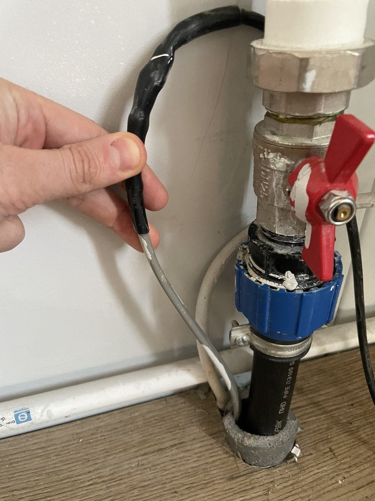
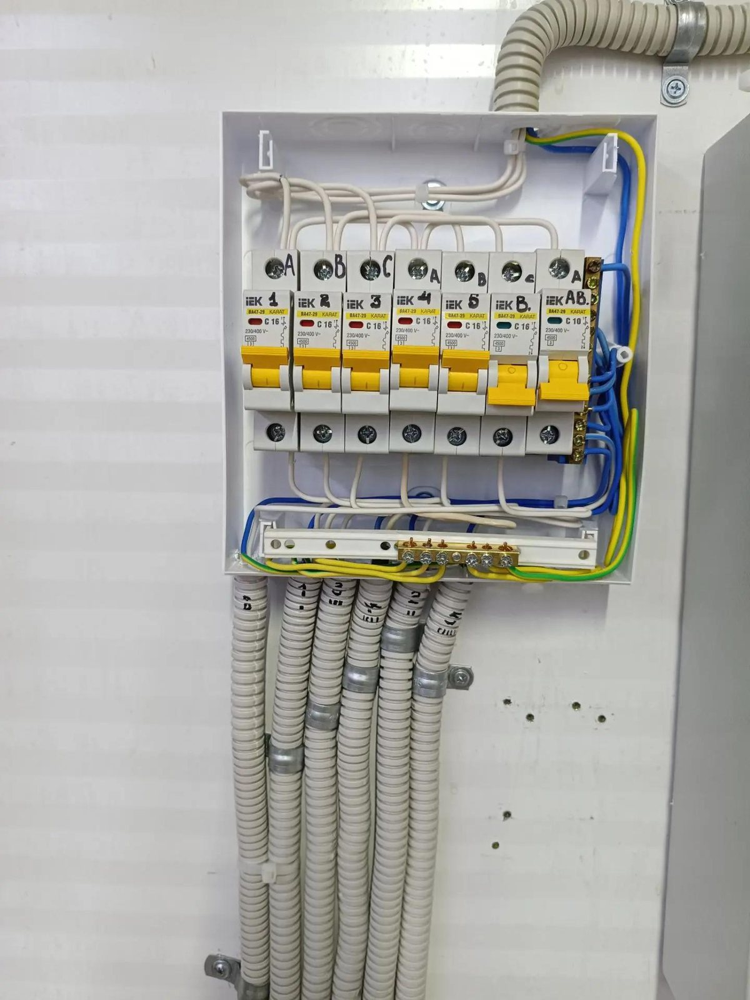

Сосульки с карниза и «ледяная плита» в желобе выглядят безобидно, пока вода не пойдёт под черепицу или не оторвёт водосток. В Самаре и области зима с оттепелями: снег тает, стекает к карнизу, там снова минус — и лёд нарастает слой за слоем. Обогрев кровли и водостоков греющим кабелем иногда спасает ситуацию, а иногда только греет воздух и крутит счётчик.

Разберём, где обогрев оправдан, чем саморегулирующийся кабель отличается от «обычного греющего», как завести линию в щиток и что чаще всего ломается на объектах. Работы на крыше и в щитке под напряжением — для подготовленных электромонтёров; с кровли без страховки и навыков лучше не лезть.

## Зачем вообще греют кровлю и желоба

Лёд в водостоке растёт не из ниоткуда: тёплый воздух из чердака или плохая вентиляция подкровельного пространства подтаивает снег у конька, вода бежит к холодному карнизу и замерзает. Получается барьер — вода ищет путь под гидроизоляцию, в стыки, под софиты. Отсюда протечки весной и обледенелые «сосульки-фонтаны» над крыльцом.

Греющий кабель не чинит теплопотери через крышу и не заменяет нормальную вентиляцию. Он **локально** держит тёплыми карниз, желоб, трубу водостока и иногда узкую полосу у кромки кровли — там, где вода должна уйти, а не застыть. Если проблема в утеплении мансарды, обогрев ленты на желобе борется со следствием, а не с причиной.

| Симптом | С чего начинают, до кабеля |
|---|---|
| Лёд только на желобах и трубе | Уклон желоба, прочистка, крепёж |
| Лёд по всему карнизу | Вентиляция чердака, пароизоляция, утепление |
| Сосульки над входом | Карниз, снегозадержатели, иногда кабель на кромке |
| Вода под кровлю в оттепель | Гидроизоляция, причина подтаивания снега |

> **Совет мастера:** перед заказом кабеля стоит сфотографировать карниз и чердак зимой и в оттепель — так видно, тает ли снег «равномерно» или полосой у конька. Это дешевле, чем метать греющую ленту на всю длину кровли.

## Где кабель уместен, а где нет

**Имеет смысл** там, где без обогрева регулярно встаёт лёд при нормальной эксплуатации дома: длинный северный карниз, сложные ендовы, металлический желоб на холодном свесе, участок трубы над входом. На одноэтажном доме с простой двускатной кровлей и нормальной вентиляцией часто хватает желоба с уклоном и своевременной чистки.

**Не стоит ставить «на всякий случай»** на всю площадь ската: кабель на открытой кровле дорог в монтаже, в обслуживании и по электричеству. На мягкой кровле и под битумной черепицей укладку согласуют с производителем покрытия — иначе гарантию на кровлю могут снять.

Дом пустует зимой — логика другая: снега мало, обогрев крутится впустую, а при отключении света лёд всё равно нарастёт. Для сезонной дачи чаще выбирают точечный обогрев одного проблемного карниза, а не всей системы.

С греющим кабелем на трубах водопровода и канализации пересекается только идея «не дать воде застынуть»; на кровле другие нагрузки, ветер, УФ и перемонтаж. Подробнее про трубы — в [статье про греющий кабель на водопровод и канализацию](/blog/greyushchij-kabel-vodoprovod-kanalizatsiya/).

## Какой кабель берут на кровлю и в желоб

На водостоках почти всегда **саморегулирующийся** греющий кабель: на морозе он выделяет больше тепла, когда желоб уже тёплый — меньше. Его режут по длине с заводскими концевыми муфтами; произвольно скручивать и перехлёстывать без паспорта марки нельзя.

Для кромки кровли иногда ставят готовые **нагревательные секции** или ленту под металлочерепицу — это отдельные комплекты, не обрезки «с водопровода». Марку и вт/м выбирают под материал желоба (металл, ПВХ) и по климату; точные цифры — в паспорте и у поставщика, не «как у соседа».

**Резистивный** кабель с постоянной мощностью на кровле встречается реже: его не режут, перегрев на коротком участке опаснее. Если на объекте предлагают «остаток с трубы» на весь карниз — стоит остановиться и пересчитать комплект.

Внешний монтаж: кабель фиксируют в желобе или на специальных клипсах по инструкции, соединения и «холодный конец» уводят в распределительную коробку с классом защиты для улицы — не в пакете из подсобки.

На снимке — типичная укладка греющей нити вдоль трубы: по принципу крепления и вывода холодного конца похоже на участки водостока, только оболочка и марка для кровли другие.

## Электрика: линия, защита, автоматика

Обогрев кровли — **отдельная нагрузка**, не «в розетку через удлинитель». От щитка идёт своей линией: кабель по сечению по длине греющей цепи и пусковому току холодного саморега, автомат по характеристике и номиналу из проекта или паспорта комплекта, **УЗО или дифавтомат** на утечку — греющая линия снаружи, влага, корпус желоба.

Управление: терморегулятор или реле с датчиком на улице / в желобе, чтобы не греть при плюсе без нужды. «Включил в ноябре — выключил в апреле» без датчика съедает лишний ток и укорачивает срок службы кабеля.

Пусковой ток саморегулирующегося кабеля зимой выше номинала; если при включении срабатывает автомат, **не заменяют его на «побольше»** без пересчёта линии — иначе защита превращается в формальность. Та же логика, что в [материале про выбивающийся зимой автомат](/blog/vybivaet-avtomat-zimoj/).

На фото — собранный щиток с отдельными автоматами по группам: греющие линии кровли логично выделяют так же, с подписью на схеме, чтобы зимой не путать с розетками.

Зимой на селе и в Самарской области свет иногда пропадает. Если от отключения зависят насос и котёл, это отдельная тема — в [статье про резервное питание](/blog/rezervnoe-pitanie-kotla-nasos-ibp-generator/). Обогрев водостока при длительном блэкауте не спасёт уже наледь, но после восстановления питания система снова держит желоб в рабочем состоянии.

> **Совет мастера:** все наружные соединения, муфты и коробки подписывают на схеме щитка — через пять лет на крыше без подписи не вспомнить, какой автомат относится к какому карнизу.

## Типичные ошибки

**Кабель без утеплённого желоба на ветру.** Он греет воздух, лёд снаружи остаётся; счёт растёт, эффекта нет.

**Одна линия на весь дом и сад.** Длина саморега и пусковой ток ограничены паспортом; «добавили ещё десять метров» — частая причина отказа УЗО и перегрева.

**Нет заземления и зануления по схеме производителя** комплекта; соединения в неклассной коробке, кабель натянут без допуска на температурное расширение.

**Обогрев вместо ремонта кровли.** Пока вода идёт под гидроизоляцию, никакая лента на желобе не заменит разборку проблемного узла.

**Монтаж на морозе «на скорую руку».** Холодная оболочка кабеля дубеет, крепёж не держит; муфты ставят в сухую погоду по инструкции.

## Энергия и ожидания

Точный расход в кВт·ч за сезон без расчёта по длине, режиму термостата и погоде не назовёшь: у каждого объекта своя длина карниза и график «дом живёт / пустой». Зимой в Самарской области длинные «плюсовые» недели кабель с датчиком отрабатывает часы, а не сутки подряд — и это заметно снижает счёт по сравнению с постоянным включением.

Имеет смысл заранее понимать: обогрев — **обслуживание**, а не разовая покупка. Раз в сезон смотрят крепёж, коробки, автомат в щитке; после сильного снега или наледи — желоб и видимые участки кабеля. Перед отопительным сезоном полезно сверить весь чек-лист по дому — он есть в [подготовке к зиме](/blog/podgotovka-doma-k-zime-elektrika-santehnika/).

## Что запомнить

- Лёд на карнизе часто связан с вентиляцией чердака и утеплением; кабель лечит узкие места стока, а не всю крышу целиком.
- На водостоках берут саморегулирующий комплект с уличными муфтами; остатки «с трубы» на весь периметр — плохая идея.
- Линия из щитка — с отдельным автоматом, защитой по утечке и автоматикой по температуре или погоде.
- Пусковой ток зимой учитывают при выборе автомата; увеличивать номинал без расчёта нельзя.
- Монтаж на кровле и подключение в щитке — работа для электромонтёра; с паспортом комплекта и схемой в щитке проще жить следующие зимы.

Если на объекте каждый год одна и та же наледь и неясно, хватит ли желоба или нужна линия из щитка, наши специалисты по заявке с фото карниза помогут набросать вариант и **бесплатно посчитают смету** — без обещаний «бесплатного выезда». Оставить заявку можно [на главной странице сайта](/#final-cta).