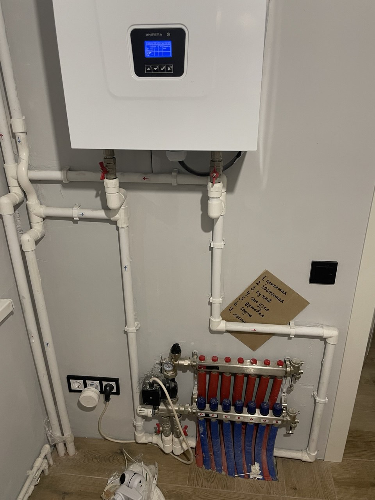
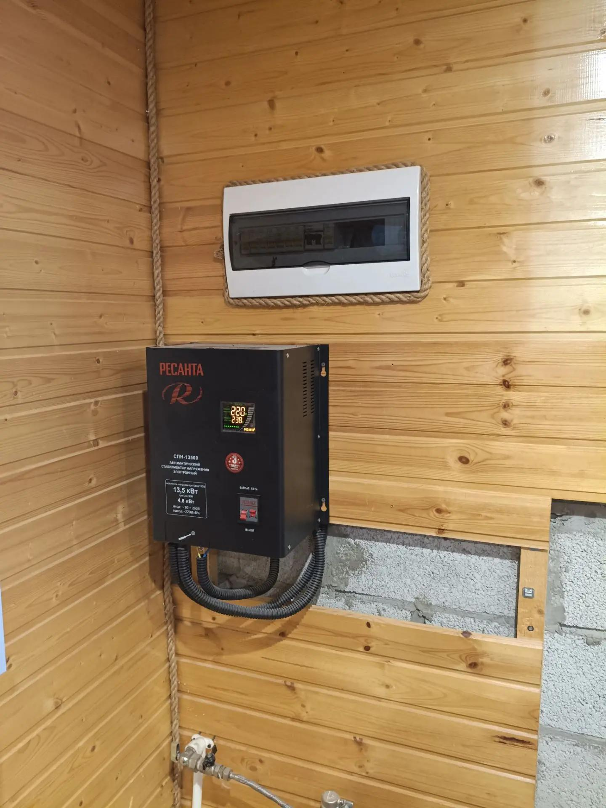
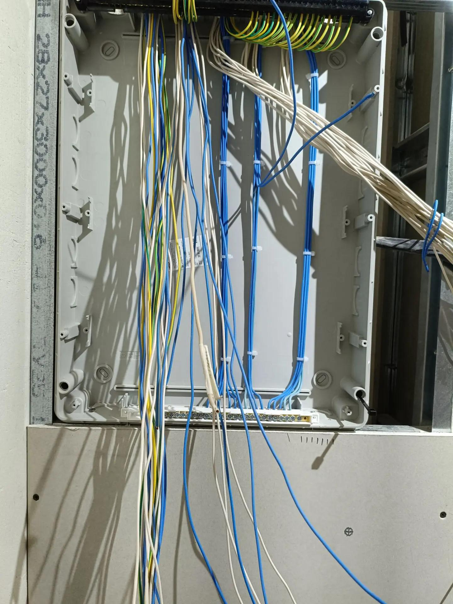

Свет погас на полчаса — и в доме уже холоднее у пола. Газовый или дизельный котёл часто не «греет сам по себе»: ему нужны розжиг, насос циркуляции, иногда второй контур и управление. Насос скважины или станции без электричества тоже молчит. В Самаре и области зимой такие паузы случаются: линия, подстанция, ремонт на селе. Резервное питание не заменяет нормальный ввод, но даёт время: дом не остывает за один короткий сбой, трубы не успевают замёрзнуть, санузел не остаётся без воды.

Разберём три разных инструмента — ИБП (источник бесперебойного питания), бензиновый или дизельный генератор и стабилизатор напряжения. Это не взаимозаменяемые «коробки»: у каждого своя задача. Плюс типичные ошибки, когда котёл подключают «как розетку», а потом удивляются, что электроника не пережила скачок.

## Почему котёл и насос «садятся» без света

Современный котёл — это не только горелка. Электронный блок управления, вентилятор дымоудаления, насос отопления, реле, датчики давления и температуры — всё это потребляет ток постоянно, пока система в работе. У части моделей при пропадании сети розжиг не повторяется сам, пока не вернётся питание и не отработает защита.

Насос отопления качает теплоноситель по контурам. Без него в длинных магистралях и в тёплом полу вода может перестать циркулировать: одни зоны остынут быстрее других. Для деревянного и каркасного дома важнее не «комфорт в гостиной», а то, что замерзающий контур бьёт по отделке и фурнитуре.

Отдельная линия — насос водоснабжения: скважина, станция повышения давления, дренаж. Их мощность часто выше, чем у блока котла, зато без воды дом живёт считанные часы, а не сутки.

> **Совет мастера:** перед покупкой ИБП или генератора сфотографируйте шильдик котла и насосов и выпишите мощность с паспортов. «На глаз» часто берут запас в три раза — и переплачивают за генератор, который никогда не включат на полную.

## ИБП: короткие отключения и чувствительная электроника

ИБП держит нагрузку минуты или, у тяжёлых стоек, до пары часов — в зависимости от ёмкости аккумуляторов и того, сколько ватт реально тянет котёл с насосами. Его сильная сторона — мгновенное переключение: плата котла не «видит» провала, розжиг не сбивается.

Для котла обычно нужен ИБП с **чистой синусоидой** на выходе (online или line-interactive с качественным инвертором). «Для компьютера» с упрощённой формой сигнала иногда не любят блоки управления и частотные насосы — поведение непредсказуемое, смотрите рекомендации производителя котла.

| Задача | ИБП подходит? |
|---|---|
| Сбой на 5–30 минут, сохранить розжиг и насос | Да, при правильной мощности |
| Ночь без света на даче | Обычно нет, нужен генератор или запас топлива |
| Только реле и один насос | Иногда хватит меньшей модели |
| Скважинный насос 1,5–2,2 кВт | Отдельный расчёт: пусковой ток большой |

ИБП ставят в тёплом сухом месте: аккумуляторы на морозе теряют ёмкость, в котельной с сыростью служат хуже. Отдельная линия от щитка — через автомат и, при необходимости, УЗО (устройство защитного отключения). Нельзя «втыкать» котёл в удлинитель через весь дом: при сбое на соседней группе отключится и отопление.

## Генератор: длинные отключения и несколько потребителей

Переносной или стационарный генератор даёт киловатты на часы и сутки, пока есть топливо. Для дома с электрокотлом или мощной насосной станцией это часто единственный реалистичный вариант на длинный мороз. Минусы: шум, выхлоп, обслуживание, нужно **безопасно** подключить к нагрузке.

Варианты подключения:

- **Через ATS (автомат ввода резерва)** — правильный путь для постоянной схемы: генератор не «кормит» улицу, сеть и резерв не встречаются.
- **Через разъём ввода** — только если схему собрал электромонтёр и есть блокировка от параллельной работы с сетью.
- **Удлинитель в розетку котла** — аварийный костыль на свой страх и риск; обратная подача в линию опасна для соседей и ремонтников.

Мощность генератора считают по **сумме** постоянных потребителей плюс пусковые токи насосов. Электрокотёл на десять киловатт и «генератор на три» — несовместимы. Газовый котёл с насосом часто укладывается в скромнее, но цифры — только из паспортов.

Генератор ставят на улице или в отдельном сарае с выводом выхлопа наружу. Кабель — сечением по нагрузке, не «что нашлось в гараже». Заземление и защита — по правилам для временных установок; точные требования лучше уточнять у специалиста на объекте.

На снимке — узел с электрокотлом и коллектором водяного тёплого пола: при пропадании питания останавливаются и насос, и электроника котла.

## Стабилизатор: не резерв, но часто рядом с котлом

Стабилизатор **не выдаёт свет**, когда линия мёртва. Он выравнивает просадки и скачки, когда сеть есть. На селе и в посёлках у Самары напряжение «гуляет» — и блок управления котла, и частотный насос могут уходить в ошибку или просто изнашиваться быстрее.

На фото — настенный стабилизатор под щитком в доме из дерева: типичная связка «ввод → стабилизация → группы», когда техника чувствительна к сети.

Стабилизатор и ИБП решают разные проблемы. Иногда их **комбинируют**: стабилизатор на вводе в котельную, а ИБП — только на цепь управления. Генератор при этом всё равно нужен, если света нет совсем. Путать «стабилизатор» с «резервом» — частая покупка зря: зимой при полном отключении он бесполезен.

> **Совет мастера:** если котёл уже ругается на сеть, сначала замеряют напряжение в разное время суток. Иногда хватает перераспределения групп или отдельной линии от щитка, а не самого мощного стабилизатора в подвале.

## Как выбрать схему под ваш дом

Упростим до вопросов, которые задают на объекте:

1. **Как часто и надолго пропадает свет?** Редко и ненадолго — ИБП на котёл и насос отопления. Несколько раз за зиму по несколько часов — генератор или стационарный резерв.
2. **Что критичнее — тепло или вода?** Для скважины часто делают отдельный автомат и свой ИБП или включают насос в общий резерв с расчётом пускового тока.
3. **Какой котёл?** Электроника и частотник требуют качественного сигнала; старый релейный проще по питанию, но насос всё равно нужен.
4. **Есть ли место в щитке?** Резерв — это ещё автоматы, иногда контактор, кабель до генератора. Про запас модулей — в материале [про щиток в частном доме](/blog/shchitok-v-chastnom-dome/).

| Решение | Свет есть | Света нет | Типичная нагрузка |
|---|---|---|---|
| ИБП | Работает от сети, подзаряжает АКБ | Держит ограниченное время | Котёл + малый насос |
| Генератор | Обычно стоит | Основной источник | Дом, котёл, насосы |
| Стабилизатор | Выравнивает U | Не работает | Чувствительная техника |

Зимой перегрузка сети обогревателями иногда «роняет» напряжение по посёлку — это не то же самое, что полное отключение. Стабилизатор здесь помогает; ИБП — только если просадка превращается в полное обесточивание группы.

## Монтаж и безопасность

Работы в щитке, согласование ввода резерва и заземление генератора — для квалифицированного электромонтёра. Самодельная «перекидушка» с сети на генератор без блокировки — риск удара для людей на линии и пожар при перегреве кабеля.

Наши мастера на объектах обычно:

- выделяют **отдельную группу** «котёл / насос / критичное»;
- не вешают на эту группу электроплиту и обогреватели — при сбое резерв сядет первым;
- проверяют, что удлинитель и временная схема не остаются на годы;
- оставляют схему понятной следующему человеку: подписи, однолинейный эскиз в щитке.

После монтажа полезен **пробный сценарий**: отключить ввод (или симулировать сбой) и убедиться, что котёл перешёл на ИБП или что генератор запускается по инструкции. Делать это лучше днём, не в мороз −25 °C.

Кадр с объекта — щит до установки модулей: видно, сколько линий уходит в дом; под котёл и насос часто закладывают отдельные кабели ещё на этом этапе.

Про зимние перегрузки и «выбивает автомат» — отдельно в статье [почему выбивает автомат зимой](/blog/vybivaet-avtomat-zimoj/). Резервное питание не спасёт, если основная группа уже перегружена обогревателями.

## Что запомнить

- Котёл и насос **не работают без электричества** — даже при газовом или дизельном тепле.
- **ИБП** — для коротких сбоев и сохранения розжига; нужна подходящая форма выходного напряжения и мощность по паспортам.
- **Генератор** — для длинных отключений; подключение только через правильную схему, без обратной подачи в сеть.
- **Стабилизатор** сглаживает скачки, но **не заменяет** резерв при полном обесточивании.
- Щиток, автоматы и кабель под резерв планируют заранее — проще на этапе [электрики в каркасе](/blog/oshibki-elektriki-karkasnyj-sip-dom/), чем переделывать готовую котельную.

Если нужно — наши специалисты посмотрят ваш щит и котельную, посчитают нагрузку и предложат схему: ИБП, ввод под генератор или комбинацию. [Оставить заявку на расчёт сметы](/#final-cta) можно на сайте — выезд и работы оцениваются отдельно, расчёт стоимости бесплатный.
